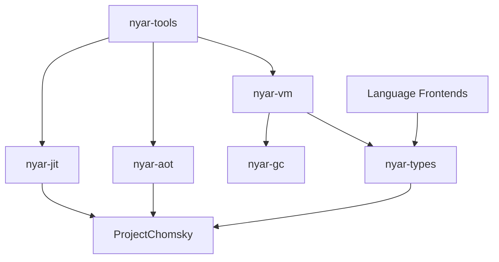
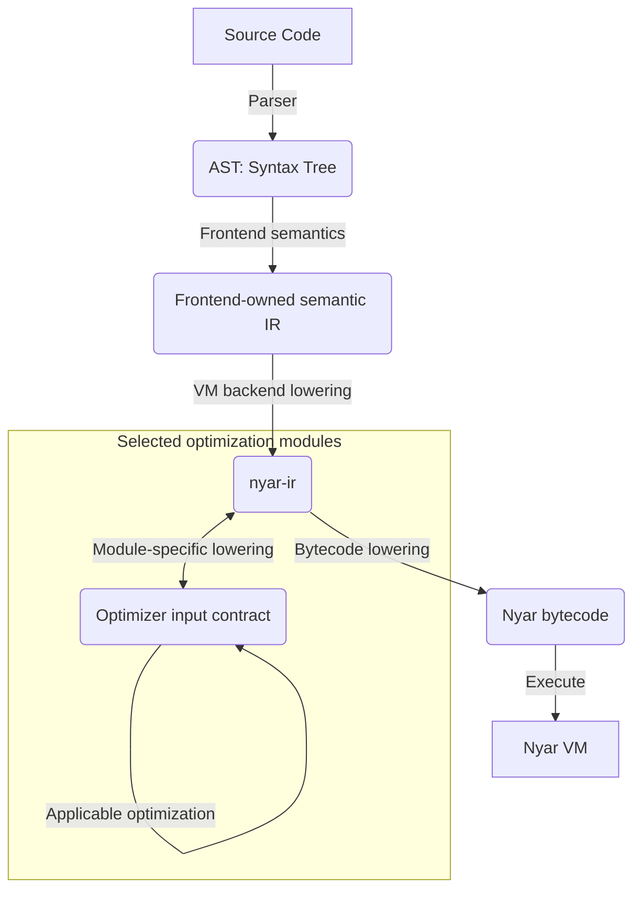

# 核心项目维护指南

Nyar VM 是 Nyar 项目中的一个后端。它维护自己的 `nyar-ir`、Nyar 字节码、验证、解释器、GC、JIT 与 AOT 链；Nyar 项目还可以有 JVM、CLR、Wasm、Native 等并列后端。各语言保留自身需要的抽象，只有选择 Nyar VM 后端时才接入该后端的输入 contract。`nyar-ir` 不是所有语言或后端必须经过的 Universal IR/UIR。

## 架构总览

Nyar VM 后端的内部职责主要分为三层：

1. **前端层 (Frontends)**: 各类编程语言前端（如 Mini-C, Mini-Java 等），负责将源码解析为 AST 并逐步降级。
2. **编译基础设施 (Infrastructure)**:
    - **nyar-types**: 可复用的 ID、contract、验证记录与 IR 基础类型；不拥有某一语言的语义事实。
    - **nyar-gc**: 托管堆内存管理。
    - **ProjectChomsky**: 可按输入 IR/模块 contract 接入的优化能力；具体模块是否服务 Nyar VM 由其输入 contract 决定。
3. **执行层 (Execution)**:
    - **nyar-vm**: 栈式字节码解释器与异步运行时。
    - **nyar-jit**: 基于热点分析的即时编译。
    - **nyar-aot**: Nyar VM 后端的静态编译驱动，负责 VM IR/字节码及其允许的目标构件；Wasm/JVM/CLR/Native 后端拥有各自的 lowering 链。
    - **nyar-tools**: 开发者工具链。

## 项目调用关系

## 编译流水线 (Pipeline)

选择 Nyar VM 后端时，前端输入按该后端 contract 降低到 `nyar-ir`，再生成 Nyar 字节码：

- **Chomsky 优化模块**: 在满足模块输入 contract 时介入，利用 E-Graph 或其他算法优化适用的 IR，不承担所有语言的统一语义。
- **Nyar VM lowering**: 只有选择 Nyar VM 后端的语言才进入 `nyar-ir` 和 Nyar 字节码。
- **其他后端 lowering**: JVM、CLR、Wasm、Native 各自拥有自己的输入表示、lowering 和输出合同，不从 Nyar VM 流水线推导。

## 项目目录

- [nyar-vm](nyar-vm.md): 核心运行时、字节码定义与解释器。
- [nyar-types](nyar-types.md): 通用基础类型与错误处理。
- [nyar-gc](nyar-gc.md): 垃圾回收器实现。
- [nyar-jit](nyar-jit.md): 即时编译器驱动。
- [nyar-aot](nyar-aot.md): 静态编译器驱动。
- [nyar-tools](nyar-tools.md): 命令行工具链。
