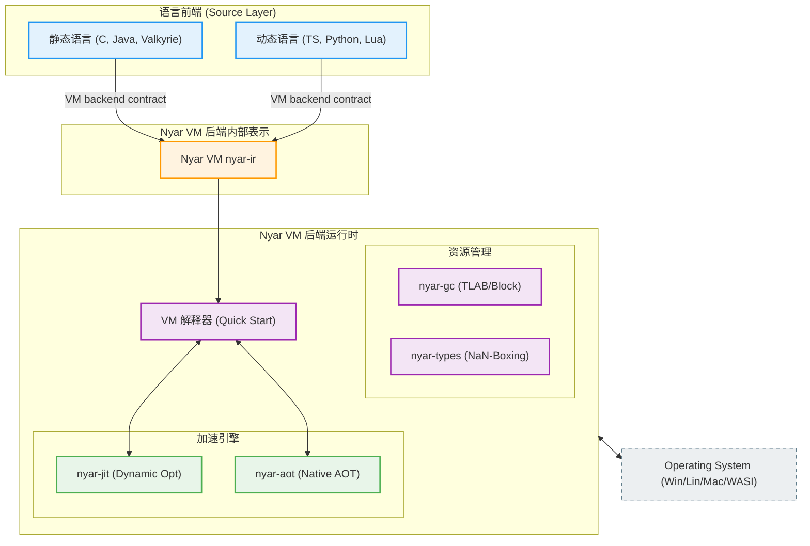
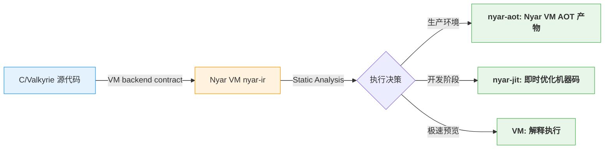
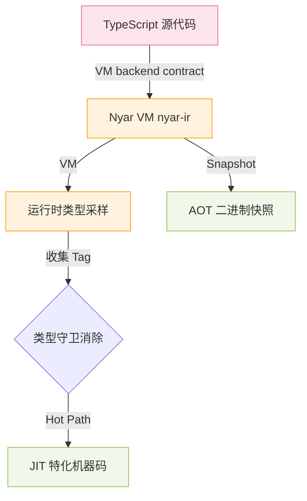
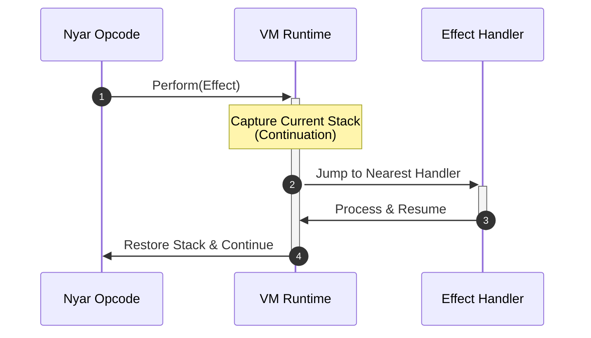
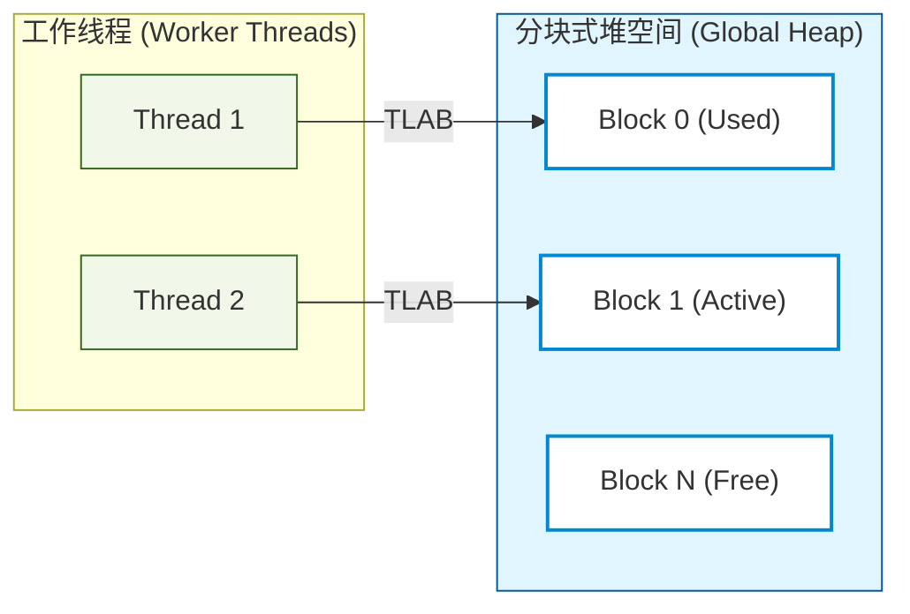

# Nyar VM

[](https://www.rust-lang.org/)
[](#)

## 💡 NyarVM 是什么？

**Nyar VM** 是 Nyar 项目中的一个编译与执行后端，负责自己的 `nyar-ir`、Nyar 字节码、解释器、GC、JIT 与 AOT 链。Nyar 项目可以拥有多个语言前端和多个并列后端；JVM、CLR、Wasm、Native 与 Nyar VM 是不同的目标后端。本文只描述 Nyar VM 后端，不把 `nyar-ir` 当作跨语言或跨后端的 Universal IR。

## 🏗️ 核心架构：三位一体的执行语言

Nyar VM 后端接收某个语言前端为该后端准备的输入 contract，并把它降低为 Nyar VM 自己的 `nyar-ir` 和字节码。语言前端仍拥有自己的语义抽象；其他后端有各自的 lowering、IR 和执行合同，不经过 `nyar-ir`。



---

## 🏎️ 混合执行策略

### 1. 静态语言流 (Static Languages)

静态语言把已闭合的语言语义交给选定的 Nyar 模块；具体 target 可以在编译或运行阶段选择 specialization、去抽象化与内联。不同语言不必经过相同的 IR 或优化闭包。



### 2. 动态语言流 (Dynamic Languages)

动态语言可以按自身语义和目标选择 **NaN-Boxing** 等运行时表示；这不是所有 frontend 的共同 IR 或强制执行路径。



#### NaN-Boxing 64-bit 内存布局

所有动态类型（指针、整数、布尔）均压缩在 8 字节字宽内，零开销识别。


---

## 🧩 核心基础设施

### 1. 代数效应 (Algebraic Effects)

`nyar-ir` 原生支持高阶控制流；Nyar VM 通过捕获 **Continuation** 实现异步与协程。这是 Nyar VM 后端的能力，不是所有后端的共同 IR 要求。



### 2. 内存管理 (nyar-gc)

专为 Nyar 执行模型设计的垃圾回收器，支持线程本地分配缓存 (TLAB)。



---

## 🏗️ 项目模块导航

| 模块           | 路径                                                                           | 功能描述                                |
|:---------------|:-------------------------------------------------------------------------------|:----------------------------------------|
| **虚拟机核心** | [`odin-vm`](./projects/runtimes/odin-vm)                                       | 字节码解释器、异步运行时及驱动          |
| **类型系统**   | [`nyar-types`](./projects/compilers/nyar-types)                                | NaN-Boxing 实现与核心类型定义           |
| **垃圾回收**   | [`nyar-gc`](./projects/runtimes/nyar-gc)                                       | 高性能分块式垃圾回收器                  |
| **加速引擎**   | [`nyar-jit`](./projects/runtimes/nyar-jit) / [`nyar-aot`](./projects/nyar-aot) | 动态与静态编译优化工具链                |
| **示例前端**   | [`examples/`](./examples)                                                      | C, Java, Go, TS 等多种语言的 Nyar 实现  |
| **语言主链**   | [`rusty-valkyrie`](./examples/rusty-valkyrie)                                    | Valkyrie 前端：`HIR` / `MIR` 与语义闭包 |

Per-crate docs live in each directory's `readme.md` (for example [
`odin-vm/readme.md`](./projects/runtimes/odin-vm/readme.md)).

---

## 🛠️ 快速开始

```powershell
# 构建全量发布版本
cargo build --release

# 运行基准测试
cargo bench -p odin-vm

# 执行 Nyar 字节码程序
cargo run -p odin-vm -- <input_file>
```

## 📖 深入探索

- [Nyar IR 指令集详情](./documentation/zh-hans/maintenance/nyar-ir.md)
- [对象级动态技术](./documentation/zh-hans/guide/dynamic.md)
- [NaN-Boxing 系统深度解析](./documentation/zh-hans/maintenance/nyar-types.md)
